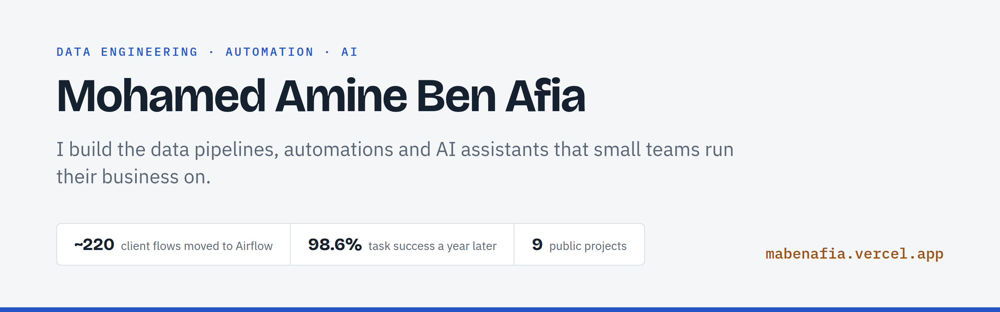

 

I build **data pipelines, web scrapers, business automations and AI assistants** for startups and small businesses. For four years I worked on a multi-tenant integration platform for a European EdTech product, and led its migration of ~220 client data flows from Celery to Apache Airflow on AWS MWAA. A year after I left, it still runs ~1,400 tasks a day for 93 client companies at 98.6% success.

Fixed scope, clear price, documented, and the code is yours. **[See services and case studies →](https://mabenafia.vercel.app)**

## 🧰 What I do

| | | Proof |
|---|---|---|
| 🔁 | **Data pipelines, syncs & migrations**: Airflow, Dagster, ETL, customer data onboarding, AWS | [Integration platform](https://mabenafia.vercel.app/work/integration-platform) · [syncline](https://github.com/MedAmine-SUDO/syncline) · [comext-trade-pipeline](https://github.com/MedAmine-SUDO/comext-trade-pipeline) |
| 🕸️ | **Web scraping**: paginated and JavaScript-heavy sites, cleaned into your database | [Health-tech database](https://mabenafia.vercel.app/work/practitioner-database) · [competitor-price-tracker](https://github.com/MedAmine-SUDO/competitor-price-tracker) |
| ⚙️ | **Business automation**: reports, alerts on Slack/email/WhatsApp, Excel and Sheets | [Textile wholesaler](https://mabenafia.vercel.app/work/textile-stock-attendance) · [Meeting rooms](https://mabenafia.vercel.app/work/meeting-rooms) · [ghostbooking](https://github.com/MedAmine-SUDO/ghostbooking) |
| 🤖 | **AI assistants**: answers from your own documents, leads to Google Sheets, MCP servers | [ai-customer-assistant](https://github.com/MedAmine-SUDO/ai-customer-assistant) · [learnhub-mcp-server](https://github.com/MedAmine-SUDO/learnhub-mcp-server) |

## 🚀 Featured projects

| Project | What it does | Built with |
|---|---|---|
| **[syncline](https://github.com/MedAmine-SUDO/syncline)** · [releases ↗](https://github.com/MedAmine-SUDO/syncline/releases) | Customer HR files in, clean records out: one YAML file per customer instead of an import script, a dry-run diff, a rejected-rows report and a guard against half-exported files. Files, S3 or SFTP into a database or an API | Python · Polars · SQLAlchemy |
| **[comext-trade-pipeline](https://github.com/MedAmine-SUDO/comext-trade-pipeline)** · [live ↗](https://eu-trade-explorer.streamlit.app/) | Sensor-driven, idempotent pipeline mirroring Eurostat's COMEXT trade data (~5M rows/month), with a public dashboard | Dagster · Polars · DuckDB |
| **[ai-customer-assistant](https://github.com/MedAmine-SUDO/ai-customer-assistant)** · [demo ↗](https://ai-customer-assistant-demo.vercel.app) | Answers customers from a business's own documents in French, English and Tunisian darija, captures leads, alerts the team | FastAPI · pgvector · n8n |
| **[competitor-price-tracker](https://github.com/MedAmine-SUDO/competitor-price-tracker)** · [demo ↗](https://medamine-sudo.github.io/competitor-price-tracker/) | Daily prices from Tunisian e-shops, matched across sites, with history, Excel report and email alerts | Python · PostgreSQL |
| **[order-invoice-api](https://github.com/MedAmine-SUDO/order-invoice-api)** | Orders, invoices, credit notes, payments and the TVA journal for a Tunisian shop or distributor | FastAPI · PostgreSQL · Docker |
| **[learnhub-mcp-server](https://github.com/MedAmine-SUDO/learnhub-mcp-server)** | Multi-tenant MCP server: AI assistants answer from any company's own LMS API or database, configured in YAML instead of code | MCP · REST · SQL · AWS Lambda |
| **[ghostbooking](https://github.com/MedAmine-SUDO/ghostbooking)** · [PyPI ↗](https://pypi.org/project/ghostbooking/) | Clears forgotten meeting-room bookings in a shared Excel/Sheets file and reminds people with one-tap Keep / Release | Python · Slack · Teams |
| **[paris2024-training-camps](https://github.com/MedAmine-SUDO/paris2024-training-camps)** · [live ↗](https://paris2024-training-camps.streamlit.app/) | Tested scraper + clean dataset of 999 Olympic training camps + map | Python · Streamlit |
| **[savebrain](https://github.com/MedAmine-SUDO/savebrain)** · [live ↗](https://medamine-sudo.github.io/savebrain/) | Turns saved Instagram/Facebook posts into a private to-do list | React · Supabase |
| **[airflow-etl-template](https://github.com/MedAmine-SUDO/airflow-etl-template)** | Tested Airflow ETL starter: CRM API → S3, one-command local setup | Airflow · S3 · Pytest |

## 🛠️ Stack

| | |
|---|---|
| **Orchestration** | -017CEE?style=flat-square&logo=apacheairflow&logoColor=white)    |
| **Processing** |      |
| **Storage** |     |
| **Backend & AI** |    |
| **Cloud & Ops** |       |

## 🤝 Open source contributions

- **[argilla-io/argilla](https://github.com/argilla-io/argilla)**: documentation build fix (merged)
- **[agardnerIT/tracepusher](https://github.com/agardnerIT/tracepusher)**: two OpenTelemetry documentation fixes (merged)

## 🔭 Right now

- Taking on projects and retainers: **pipelines, scraping, automation, AI assistants**. Start with a [free 20-min call](https://cal.com/mabenafia/intro) or a fixed-price audit.
- Posting what I learn while building on [LinkedIn](https://linkedin.com/in/mabenafia).

 

<picture>
  <source media="(prefers-color-scheme: dark)" srcset="https://raw.githubusercontent.com/MedAmine-SUDO/MedAmine-SUDO/output/github-snake-dark.svg" />
  
</picture>
