 

I build **ETL pipelines and cloud data platforms** — 4+ years of making data show up on time, correct, and boring.

Most recently I led a **150+ task Celery → Apache Airflow (MWAA) migration** for a multi-tenant EdTech platform serving hundreds of schools:

<table>
  <tr>
    <td align="center"><h2>−50%</h2>production incidents</td>
    <td align="center"><h2>+40%</h2>processing performance</td>
    <td align="center"><h2>150+</h2>tasks migrated</td>
  </tr>
</table>

## 🛠️ Stack

| | |
|---|---|
| **Orchestration** | -017CEE?style=flat-square&logo=apacheairflow&logoColor=white)   |
| **Processing** |      |
| **Storage** |     |
| **Cloud & Infra** |     |
| **Quality & Ops** |     |

## 🚀 Featured work

### Data engineering

| Project | What it does | Built with |
|---|---|---|
| **[comext-trade-pipeline](https://github.com/MedAmine-SUDO/comext-trade-pipeline)** | Sensor-driven, partitioned, idempotent pipeline that keeps a local copy of Eurostat's COMEXT trade data up to date | Dagster · Polars · DuckDB · Pydantic |
| **[finpulse](https://github.com/MedAmine-SUDO/finpulse)** | Real-time fintech transaction analytics & fraud detection on a medallion lakehouse | Azure · Databricks · dbt · Terraform |
| **[competitor-price-tracker](https://github.com/MedAmine-SUDO/competitor-price-tracker)** · [demo ↗](https://medamine-sudo.github.io/competitor-price-tracker/) | Daily price tracking across 5 Tunisian e-shops with cross-site product matching and price-drop alerts | Playwright · PostgreSQL · Streamlit |
| **[airflow-etl-template](https://github.com/MedAmine-SUDO/airflow-etl-template)** | Production-ready Airflow ETL starter: CRM API → S3, tested, one-command local setup | Airflow · AWS S3 · Pytest · Docker |

### Products I've shipped

| Project | What it does |
|---|---|
| **[SaveBrain](https://github.com/MedAmine-SUDO/savebrain)** · [live ↗](https://medamine-sudo.github.io/savebrain/) | Turns your saved Instagram/Facebook posts into a private, prioritized to-do list |
| **[Job Tracker](https://github.com/MedAmine-SUDO/job-tracker)** · [live ↗](https://job-tracker-eta-lemon.vercel.app) | Job-application tracker built on Clean Architecture — swap DB/auth/storage with one env var |
| **[Quran Puzzles](https://github.com/MedAmine-SUDO/quran-puzzles)** | Bilingual Arabic/English puzzle game for hifz review |

## 🤝 Open source

- **[argilla-io/argilla](https://github.com/argilla-io/argilla)** — documentation build fix (merged)
- **[agardnerIT/tracepusher](https://github.com/agardnerIT/tracepusher)** — two OpenTelemetry documentation fixes (merged)

## 🔭 Right now

- Writing a case study on the Celery → Airflow (MWAA) migration
- Taking on freelance/contract work: **ETL design, Airflow migrations, AWS pipeline builds**
- Happy to talk orchestration tooling — [message me on LinkedIn](https://linkedin.com/in/mabenafia)

 

<picture>
  <source media="(prefers-color-scheme: dark)" srcset="https://raw.githubusercontent.com/MedAmine-SUDO/MedAmine-SUDO/output/github-snake-dark.svg" />
  
</picture>
